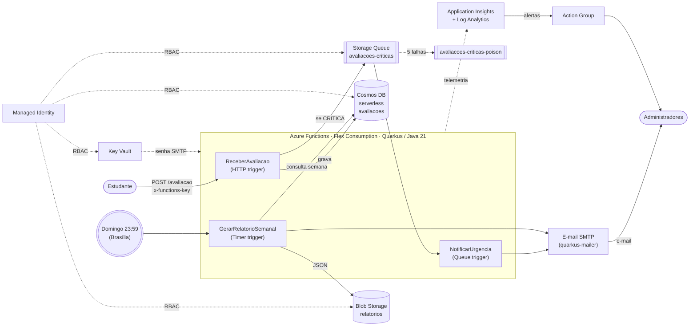

# Plataforma de Feedback — Tech Challenge Fase 4 (FIAP ADJT)

Plataforma **serverless** na **Microsoft Azure** para estudantes avaliarem aulas e administradores acompanharem a satisfação:

- **Recebe avaliações** via `POST /avaliacao` e grava no banco;
- **Notifica por e-mail**, na hora, os administradores sobre avaliações **críticas**;
- **Gera um relatório semanal** com a média das avaliações, a quantidade por dia e a quantidade por urgência.

**Stack:** Java 21 · Quarkus 3 (extensões `quarkus-azure-functions`, `quarkus-hibernate-validator`, `quarkus-jackson`) · Azure Functions (Flex Consumption) · Cosmos DB serverless · Storage Queue/Blob · E-mail via SMTP (extensão `quarkus-mailer`) · Key Vault · Application Insights · Bicep · GitHub Actions.

---

## Sumário

1. [Modelo de cloud escolhido](#1-modelo-de-cloud-escolhido)
2. [Arquitetura da solução](#2-arquitetura-da-solução)
3. [Funções serverless](#3-funções-serverless)
4. [Segurança e governança](#4-segurança-e-governança)
5. [Monitoramento](#5-monitoramento)
6. [Instruções de deploy](#6-instruções-de-deploy)
7. [Testando a aplicação](#7-testando-a-aplicação)
8. [Execução local](#8-execução-local)
9. [Qualidade de código e testes](#9-qualidade-de-código-e-testes)
10. [Custos](#10-custos)
11. [Estrutura do projeto](#11-estrutura-do-projeto)

---

## 1. Modelo de cloud escolhido

| Decisão | Escolha | Motivo |
|---|---|---|
| **Modelo de implantação** | Nuvem **pública** (Microsoft Azure) | Sem infraestrutura própria, paga-se pelo uso e há serviços gerenciados para tudo que o desafio pede. |
| **Modelo de serviço** | **FaaS / Serverless** (Azure Functions) + **PaaS** gerenciados | A regra do desafio exige serverless. As funções só rodam (e só custam) quando há uma requisição, uma mensagem na fila ou o agendamento semanal. Banco, filas, e-mail e monitoramento são PaaS: a Azure cuida de servidor, patch e disponibilidade. |
| **Plano das Functions** | **Flex Consumption** (Linux) | É o plano serverless recomendado hoje pela Microsoft: escala até zero, cobra por execução e permite limitar o número máximo de instâncias (controle de custo). |
| **Banco** | **Cosmos DB for NoSQL — modo serverless** | Paga-se por operação (RU consumida), sem capacidade reservada. Bom para volume baixo e irregular e para os créditos limitados. |
| **Framework** | **Quarkus** + `quarkus-azure-functions` | Injeção de dependência (CDI), Bean Validation e Jackson nas funções, inicialização rápida e baixo consumo de memória, o que reduz o cold start. |

**Por que não IaaS (VM)?** Com VM a equipe teria que gerenciar o sistema operacional, as atualizações e a escala, e pagaria pela máquina ligada 24h, mesmo sem nenhum acesso. **Por que não Container Apps / Web Apps?** Atenderiam a API, mas o desafio exige funções serverless com responsabilidade única. Os gatilhos nativos das Functions (HTTP, fila e timer) cobrem os três fluxos sem servidor para administrar.

---

## 2. Arquitetura da solução



### Fluxos

1. **Registrar avaliação** — o estudante envia `{"descricao": "...", "nota": 0..10}`. A `ReceberAvaliacao` valida os dados, calcula a urgência, grava no Cosmos DB e responde **201**. Se a avaliação for **crítica**, publica uma mensagem na fila. A API não espera o envio do e-mail.
2. **Notificar urgência** — a fila dispara a `NotificarUrgencia`, que envia o e-mail com **descrição, urgência e data de envio**. Se o envio falhar, a mensagem é reprocessada até 5 vezes. Depois disso, vai para a fila *poison* e um **alerta** avisa a equipe.
3. **Relatório semanal** — todo **domingo às 23:59 (Brasília)** a `GerarRelatorioSemanal` consulta a semana no Cosmos DB, calcula **média**, **quantidade por dia** e **quantidade por urgência**, lista as avaliações (descrição, urgência e data), salva o JSON no Blob e envia o resumo por e-mail.

### Classificação de urgência

| Nota | Urgência | Ação |
|---|---|---|
| 0 a 3 | `CRITICA` | e-mail imediato aos administradores + relatório |
| 4 a 6 | `MEDIA` | relatório semanal |
| 7 a 10 | `BAIXA` | relatório semanal |

### Componentes

| Componente | Recurso Azure | Papel |
|---|---|---|
| Funções | Function App (Flex Consumption, Java 21) | As 3 funções serverless |
| Banco | Cosmos DB for NoSQL (serverless), container `avaliacoes`, partição `/diaEnvio` | Armazena as avaliações |
| Mensageria | Storage Queue `avaliacoes-criticas` (+ `-poison`) | Desacopla o registro da notificação |
| Arquivos | Blob container `relatorios` | Histórico dos relatórios em JSON |
| E-mail | SMTP (Gmail) via extensão `quarkus-mailer`; Azure Communication Services como alternativa (`EMAIL_PROVEDOR=acs`) | Envio dos e-mails |
| Segredos | Key Vault (RBAC) | Senha SMTP e connection string do ACS |
| Identidade | User-Assigned Managed Identity | Acesso aos recursos sem senha |
| Observabilidade | Application Insights + Log Analytics + alertas + Action Group | Logs, métricas, traces e alertas |

---

## 3. Funções serverless

Documentação completa em **[docs/funcoes.md](docs/funcoes.md)**.

| Função | Gatilho | Responsabilidade única | Saídas |
|---|---|---|---|
| `ReceberAvaliacao` | HTTP `POST /avaliacao` (auth `FUNCTION`) | Validar e registrar a avaliação | Cosmos DB; fila (se crítica); resposta HTTP |
| `NotificarUrgencia` | Queue `avaliacoes-criticas` | Avisar administradores sobre avaliação crítica | E-mail (ACS) |
| `GerarRelatorioSemanal` | Timer `%RELATORIO_CRON%` | Consolidar e enviar o relatório da semana | Blob (JSON); e-mail (ACS) |

**Separação de responsabilidades:** cada função tem um gatilho, um motivo para mudar e escala de forma independente. Uma lentidão no e-mail não afeta a API, e o relatório não concorre com o tráfego dos estudantes. No código, as funções são *adapters* finos (só tratam gatilho e entrada/saída). As regras ficam nos serviços (`servico/`), no domínio (`dominio/`) e no relatório (`relatorio/`). A infraestrutura fica atrás de interfaces (`AvaliacaoRepository`, `Notificador`, `ArmazenamentoRelatorio`), o que permite testar sem Azure.

---

## 4. Segurança e governança

**Dados dos estudantes**
- **Sem senhas no código nem no repositório.** Cosmos DB, Storage e Key Vault são acessados pela **Managed Identity** da Function App (`DefaultAzureCredential`).
- **Chaves desabilitadas:** Cosmos DB com `disableLocalAuth: true` e Storage com `allowSharedKeyAccess: false`. O único acesso possível é por identidade do Entra ID com papel RBAC.
- **Criptografia** em repouso (padrão Azure, chaves gerenciadas pela Microsoft) e em trânsito (HTTPS obrigatório, **TLS 1.2** mínimo em todos os serviços, FTP desabilitado).
- **Sem acesso público** aos blobs. Relatórios em container privado, com *soft delete* de 7 dias.
- Os segredos (senha SMTP e connection string do ACS) ficam no **Key Vault** e chegam à função por *Key Vault reference* (`@Microsoft.KeyVault(...)`). No GitHub, a senha é um *secret* (`SMTP_SENHA`), nunca um arquivo.
- **API protegida** por chave de função (`x-functions-key`). Requisições sem chave recebem 401.
- **Validação de entrada** com Bean Validation (`@NotBlank`, `@Size(max=2000)`, `@Min(0)`, `@Max(10)`), mais as regras do domínio. Nota decimal (`7.5`) é rejeitada, e não truncada. Erros internos não expõem detalhes ao cliente.

**Governança de acesso (menor privilégio)**

| Quem | Papel | Escopo |
|---|---|---|
| Identidade da Function App | Storage Blob Data Owner, Storage Queue Data Contributor, Storage Table Data Contributor | Storage account |
| Identidade da Function App | Key Vault Secrets User (somente leitura de segredos) | Key Vault |
| Identidade da Function App | Cosmos DB Built-in Data Contributor (plano de dados) | Conta Cosmos |
| Pipeline GitHub Actions | Contributor + Role Based Access Control Administrator | **Somente** o resource group |
| Operador da demo (opcional) | Cosmos Data Contributor, Storage Blob Data Reader | Conta Cosmos / Storage |

- **Deploy sem segredos de longa duração:** o GitHub autentica no Azure via **OIDC** (credencial federada), sem *client secret*.
- **Tags** de governança em todos os recursos (`projeto`, `ambiente`, `curso`, `gerenciadoPor`).
- **Infraestrutura como código** (Bicep): qualquer mudança passa por PR e fica versionada.
- **Controle de custo:** teto de 40 instâncias nas Functions e cota diária de 1 GB no Log Analytics.

---

## 5. Monitoramento

Tudo cai no **Application Insights** (workspace-based, no Log Analytics):

- **Requests**: cada execução de função, com duração e sucesso/falha;
- **Traces**: logs estruturados (`avaliacao_registrada id=... urgencia=...`, `notificacao_urgencia ...`, `relatorio_gerado ...`);
- **Exceptions**, **Dependencies** (chamadas ao Cosmos, Blob e ACS) e **Live Metrics** em tempo real.

### Alertas configurados (Azure Monitor → Action Group → e-mail)

| Alerta | Severidade | Condição (a cada 5 min) |
|---|---|---|
| Falhas em execuções das funções | 1 | `requests` com `success == false` |
| Avaliação crítica sem notificação | 0 | mensagem movida para a fila *poison* |
| Latência alta no `POST /avaliacao` | 3 | p95 da `ReceberAvaliacao` > 3 s |

### Consultas KQL úteis (Application Insights → Logs)

```kusto
// Execuções por função (última hora)
requests
| where timestamp > ago(1h)
| summarize execucoes = count(), falhas = countif(success == false), p95_ms = percentile(duration, 95) by name

// Avaliações registradas por urgência
traces
| where message startswith "avaliacao_registrada"
| extend urgencia = extract("urgencia=(\\w+)", 1, message)
| summarize total = count() by urgencia, bin(timestamp, 1h)
| render columnchart

// Notificações enviadas
traces | where message startswith "notificacao_urgencia" | order by timestamp desc

// Relatórios gerados
traces | where message startswith "relatorio_gerado" | project timestamp, message
```

Detalhes e passo a passo para mostrar no vídeo: **[docs/monitoramento.md](docs/monitoramento.md)**.

---

## 6. Instruções de deploy

### Pré-requisitos
- Conta Azure (Azure for Students serve) e **Azure CLI** (`az login`);
- **Java 21** e **Maven 3.9+**;
- Repositório no **GitHub** (público, conforme o entregável).

### Passo 1 — Configuração inicial (uma vez)

```bash
./scripts/configurar-azure.sh <owner>/<repositorio> rg-feedback-dev brazilsouth
```

O script cria o resource group, a App Registration com credencial federada (OIDC) e os papéis RBAC do pipeline. No final, mostra os valores para cadastrar no GitHub:

| Tipo | Nome | Valor |
|---|---|---|
| Secret | `AZURE_CLIENT_ID` | appId exibido |
| Secret | `AZURE_TENANT_ID` | tenant exibido |
| Secret | `AZURE_SUBSCRIPTION_ID` | assinatura exibida |
| Variable | `AZURE_RESOURCE_GROUP` | `rg-feedback-dev` |
| Variable | `EMAILS_ADMINISTRADORES` | `["voce@exemplo.com"]` (array JSON) |
| Variable | `SMTP_USUARIO` | conta Gmail que envia os e-mails (ex.: `voce@gmail.com`) |
| Secret | `SMTP_SENHA` | **senha de app** do Google dessa conta (16 caracteres) |

> **Senha de app do Google:** ative a verificação em duas etapas na conta e gere a senha em https://myaccount.google.com/apppasswords. Sem `SMTP_USUARIO`/`SMTP_SENHA`, o deploy usa o Azure Communication Services.

Crie também o environment **`dev`** em *Settings → Environments*.

### Passo 2 — Deploy automatizado

Faça push na `main`, ou rode o workflow **Deploy Azure** manualmente. O pipeline (`.github/workflows/deploy.yml`):

1. compila e roda os testes (`mvn verify`);
2. autentica no Azure via OIDC;
3. aplica o **Bicep** (`infra/main.bicep`). É idempotente: cria na primeira vez e só atualiza depois;
4. publica as funções (`target/azure-functions/feedback-functions`) com `azure/functions-action`.

PRs e outras branches rodam só o **CI** (`ci.yml`): build, testes e validação do Bicep.

### Deploy manual (alternativa)

```bash
mvn clean package
az deployment group create -g rg-feedback-dev -f infra/main.bicep \
  -p infra/main.parameters.json -p emailsAdministradores='["voce@exemplo.com"]'

APP=$(az functionapp list -g rg-feedback-dev --query "[0].name" -o tsv)
cd target/azure-functions/feedback-functions && zip -r ../pacote.zip . && cd -
az functionapp deployment source config-zip -g rg-feedback-dev -n "$APP" --src target/azure-functions/pacote.zip
```

### Remover tudo (economizar créditos)

```bash
az group delete -n rg-feedback-dev --yes --no-wait
```

---

## 7. Testando a aplicação

```bash
RG=rg-feedback-dev
APP=$(az functionapp list -g $RG --query "[0].name" -o tsv)
CHAVE=$(az functionapp function keys list -g $RG -n $APP --function-name ReceberAvaliacao --query default -o tsv)
URL=https://$(az functionapp show -g $RG -n $APP --query defaultHostName -o tsv)

# Avaliação crítica -> 201 + e-mail aos administradores
curl -i -X POST "$URL/avaliacao" -H "Content-Type: application/json" -H "x-functions-key: $CHAVE" \
  -d '{"descricao": "O vídeo da aula não carrega", "nota": 1}'

# Validação -> 400
curl -i -X POST "$URL/avaliacao" -H "Content-Type: application/json" -H "x-functions-key: $CHAVE" \
  -d '{"descricao": "", "nota": 11}'

# Disparar o relatório agora (sem esperar domingo)
MASTER=$(az functionapp keys list -g $RG -n $APP --query masterKey -o tsv)
curl -i -X POST "$URL/admin/functions/GerarRelatorioSemanal" -H "Content-Type: application/json" \
  -H "x-functions-key: $MASTER" -d '{"input": ""}'
```

Resposta de sucesso (`201 Created`):

```json
{
  "id": "9b2f3c1e-4c1a-4b8e-9f43-2a7d5c0e8f11",
  "descricao": "O vídeo da aula não carrega",
  "nota": 1,
  "urgencia": "CRITICA",
  "dataEnvio": "2026-11-12T17:42:00Z"
}
```

O arquivo [`requests.http`](requests.http) tem todos os cenários prontos para o VS Code (REST Client) ou o IntelliJ.

> Os e-mails saem da conta Gmail configurada em `SMTP_USUARIO`. Na primeira vez, confira a caixa de spam.

---

## 8. Execução local

Requer Docker e o [Azure Functions Core Tools v4](https://learn.microsoft.com/azure/azure-functions/functions-run-local).

```bash
docker compose up -d                     # Azurite (Storage) + emulador do Cosmos DB
# Crie o banco "feedback" e o container "avaliacoes" (partition key /diaEnvio)
# no Data Explorer do emulador: http://localhost:1234

cp local.settings.json.example local.settings.json
mvn clean package
cp local.settings.json target/azure-functions/feedback-functions/
cd target/azure-functions/feedback-functions && func start
```

Localmente, sem `EMAIL_CONNECTION_STRING`, os e-mails são **apenas registrados no log** (`LogNotificador`). O timer roda a cada 5 minutos (`RELATORIO_CRON` no `local.settings.json`).

---

## 9. Qualidade de código e testes

```bash
mvn verify
```

- **Testes unitários** sem dependência de Azure: domínio, classificação de urgência, validação, serviços, geração e formatação do relatório, contratos JSON (fila e documento do Cosmos), fuso horário (`America/Sao_Paulo`).
- **Arquitetura em camadas / portas e adaptadores:** `funcoes` (adapters de gatilho) → `servico` (casos de uso) → `dominio` / `relatorio` (regras puras) ← `persistencia`, `armazenamento`, `notificacao` (adapters de infraestrutura).
- Javadoc em todas as classes públicas explicando a responsabilidade de cada uma.

---

## 10. Custos

Todos os serviços são cobrados por uso. Com o volume de um desafio acadêmico, o custo fica próximo de zero ou dentro das cotas gratuitas:

| Serviço | Modelo de cobrança |
|---|---|
| Azure Functions Flex Consumption | Execuções e GB-s, com cota gratuita mensal |
| Cosmos DB serverless | RU consumida + armazenamento |
| Storage (fila e blob) | Operações + GB armazenado (centavos) |
| SMTP Gmail | Gratuito (limite diário da conta Google) |
| Application Insights / Log Analytics | GB ingerido (limitado a 1 GB/dia) |

Depois de gravar o vídeo, apague o resource group (seção 6).

---

## 11. Estrutura do projeto

```
├── src/main/java/br/com/fiap/feedback
│   ├── funcoes/        # As 3 Azure Functions (adapters finos de gatilho)
│   ├── servico/        # Casos de uso: registrar, notificar, gerar relatório
│   ├── dominio/        # Avaliacao, Urgencia, regras de negócio
│   ├── relatorio/      # Consolidação, período e formatação do relatório
│   ├── api/            # DTOs HTTP (Bean Validation) e contrato da fila
│   ├── persistencia/   # Cosmos DB
│   ├── armazenamento/  # Blob Storage
│   ├── notificacao/    # E-mail (ACS) e notificador de log (local)
│   └── config/         # Produtores CDI dos clientes Azure, Jackson, fuso
├── src/test/java/...   # Testes unitários
├── infra/main.bicep    # Toda a infraestrutura (IaC)
├── .github/workflows/  # CI e deploy automatizado (OIDC)
├── scripts/            # Configuração inicial do Azure + GitHub
├── docs/               # Funções, monitoramento, roteiro do vídeo
├── host.json           # Configuração do host das Functions
└── docker-compose.yml  # Emuladores para desenvolvimento local
```
